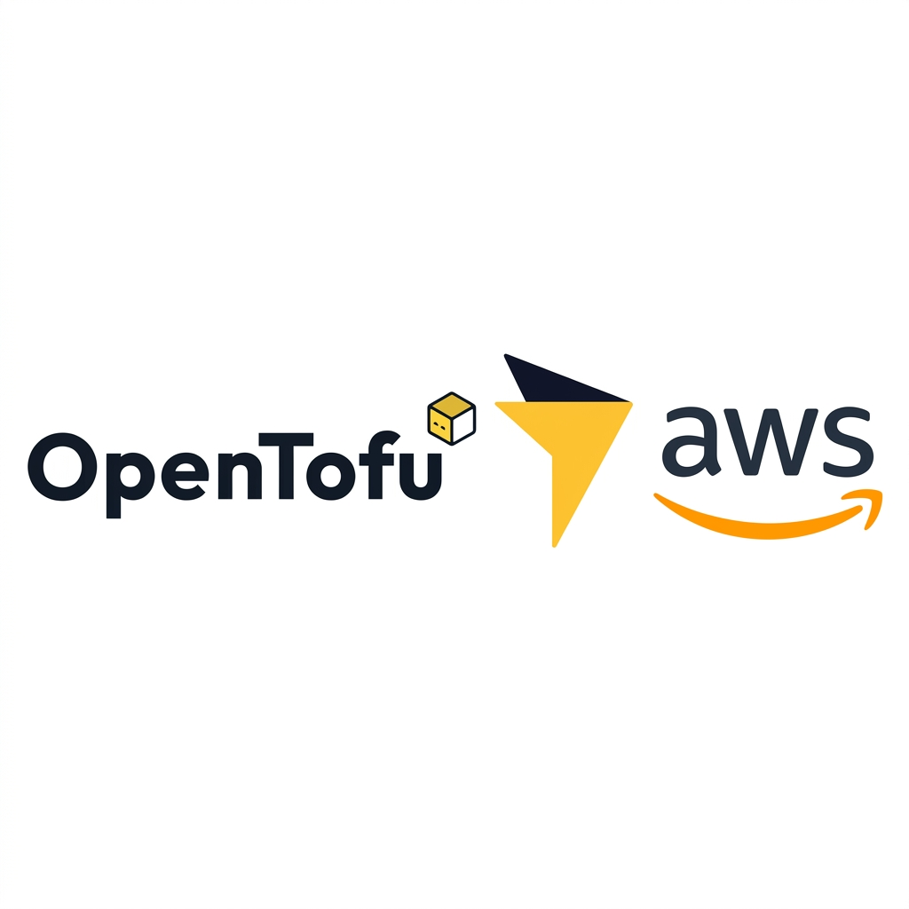

# OpenTofu/Terraform AWS Modules 

<p align="center">
  
</p>

> Simple & clean modules to use.


 

## Table of Contents

- [About](#about)
- [Getting Started](#getting-started)
- [Prerequisites](#prerequisites)
- [Available Modules](#available-modules)
- [Contributing](#contributing)

---

## About

This repository contains a **comprehensive collection of Terraform modules** for AWS services, organized by service category. Each module is designed to be:

- **Simple & Clean**: Minimal complexity with clear configuration options
- **Production-Ready**: Follows AWS best practices and security guidelines
- **Well-Documented**: Each module includes detailed README files with examples
- **Modular**: Can be used independently or composed together
- **Terraform/OpenTofu Compatible**: Works with both Terraform and OpenTofu

---

## Getting Started

### Repository Organization

This repository is organized by **AWS service categories**, with each service containing one or more specialized modules. The directory structure follows a clear hierarchy:

```sh
tofu-aws-modules/
|-- service-name/           # AWS Service (e.g., vpc, ecs, s3)
|   |-- module-name/        # Specific module (e.g., vpc, subnet, security-group)
|   |   |-- main.tf         # Main resource definitions
|   |   |-- variables.tf    # Input variables
|   |   |-- outputs.tf      # Output values
|   |   `-- README.md       # Module documentation (terraform-docs)
```

Some modules sit one or two levels deeper (for example `vpc/transit-gateway/tgw` and `elasticache/redis/standalone/cache_redis`). The path in the [Available Modules](#available-modules) table is always the one to use in `source`.

**Key Points:**
- Each module is **self-contained** and can be used independently
- Modules follow **consistent naming conventions** and structure
- Most modules include a **README** generated by terraform-docs (see the **Docs** column in [Available Modules](#available-modules))
- Variables are **well-documented** with descriptions and defaults
- Outputs are **clearly defined** for easy integration with other modules

### Module Naming Convention

Modules are referenced using the following pattern:

```hcl
module "resource_name" {
  source = "git::https://github.com/whoemai/tofu-aws-modules.git//service/module-name?ref=<tag>"

  # Your configuration here
}
```

Always pin `?ref=` to a tag. With Terragrunt, the same address goes in the `source` of the unit's `terraform` block.

---

## Prerequisites

Before using these modules, ensure you have:

- **Terraform** >= 1.0 or **OpenTofu** >= 1.6 installed
- **AWS CLI** configured with valid credentials
- **AWS Provider** configured in your code. The modules do not pin a version, so the constraint comes from your root module (the Terragrunt repository uses `>= 6.61.0`)
- Appropriate **IAM permissions** to create the resources

### Basic Provider Configuration

```hcl
terraform {
  required_version = ">= 1.0"
  
  required_providers {
    aws = {
      source  = "hashicorp/aws"
      version = ">= 6.0"
    }
  }
}

provider "aws" {
  region = "us-east-1"
}
```

---

## Available Modules

123 modules in 33 service folders. **Docs** shows whether the module has its own `README.md` (inputs, outputs and examples in the terraform-docs format). A module without it is still usable: read its `variables.tf` and `outputs.tf`.

Some folders hold more than one module for the same resource (for example `vpc/security-group`, `ec2/loadbalancer/*` and `ec2/elb/*`). Each one is a separate module with its own `source` path.

### ACM

| Module | Main resources | Docs |
|--------|----------------|:----:|
| [`acm/certificate`](./acm/certificate/) | `aws_acm_certificate` | ✅ |
| [`acm/certificate-validation`](./acm/certificate-validation/) | `aws_acm_certificate_validation` | ✅ |

### AMI

| Module | Main resources | Docs |
|--------|----------------|:----:|
| [`ami/ami`](./ami/ami/) | `aws_ami` | ✅ |
| [`ami/copy`](./ami/copy/) | `aws_ami_copy` | ✅ |

### AWS Backup

| Module | Main resources | Docs |
|--------|----------------|:----:|
| [`backup/plan`](./backup/plan/) | `aws_backup_plan` | — |
| [`backup/selection`](./backup/selection/) | `aws_backup_selection`, `aws_iam_role`, `aws_iam_role_policy_attachment` | — |
| [`backup/vault`](./backup/vault/) | `aws_backup_vault` | — |

### Cloud Map

| Module | Main resources | Docs |
|--------|----------------|:----:|
| [`cloudmap/service-discovery`](./cloudmap/service-discovery/) | `aws_service_discovery_private_dns_namespace`, `aws_service_discovery_service` | ✅ |

### Cloud9

| Module | Main resources | Docs |
|--------|----------------|:----:|
| [`cloud9`](./cloud9/) | `aws_cloud9_environment_ec2` | — |

### CloudFront

| Module | Main resources | Docs |
|--------|----------------|:----:|
| [`cloudfront/cloudfront-distribution`](./cloudfront/cloudfront-distribution/) | `aws_cloudfront_distribution` | ✅ |
| [`cloudfront/origin-access-control`](./cloudfront/origin-access-control/) | `aws_cloudfront_origin_access_control` | ✅ |
| [`cloudfront/response-headers-policy`](./cloudfront/response-headers-policy/) | `aws_cloudfront_response_headers_policy` | ✅ |

### CloudWatch

| Module | Main resources | Docs |
|--------|----------------|:----:|
| [`cloudwatch/log-group`](./cloudwatch/log-group/) | `aws_cloudwatch_log_group` | ✅ |
| [`cloudwatch/log-stream`](./cloudwatch/log-stream/) | `aws_cloudwatch_log_stream` | — |
| [`cloudwatch/metric-alarm`](./cloudwatch/metric-alarm/) | `aws_cloudwatch_metric_alarm` | ✅ |

### Data Sources

| Module | Main resources | Docs |
|--------|----------------|:----:|
| [`datasources/aws_secretsmanager_secret`](./datasources/aws_secretsmanager_secret/) | `aws_secretsmanager_secret`, `aws_secretsmanager_secret_version` | — |

### DMS

| Module | Main resources | Docs |
|--------|----------------|:----:|
| [`dms/dms_certificate`](./dms/dms_certificate/) | `aws_dms_certificate` | — |
| [`dms/dms_endpoint`](./dms/dms_endpoint/) | `aws_dms_endpoint` | — |
| [`dms/dms_event_subscription`](./dms/dms_event_subscription/) | `aws_dms_event_subscription` | — |
| [`dms/dms_replication_instance`](./dms/dms_replication_instance/) | `aws_dms_replication_instance` | — |
| [`dms/dms_replication_subnet_group`](./dms/dms_replication_subnet_group/) | `aws_dms_replication_subnet_group` | — |
| [`dms/dms_task`](./dms/dms_task/) | `aws_dms_replication_task` | — |
| [`dms/event_subscription`](./dms/event_subscription/) | `aws_dms_event_subscription` | — |

### DocumentDB

| Module | Main resources | Docs |
|--------|----------------|:----:|
| [`documentdb/cluster_instance`](./documentdb/cluster_instance/) | `aws_docdb_cluster`, `aws_docdb_cluster_instance`, `aws_docdb_cluster_parameter_group` | — |

### DynamoDB

| Module | Main resources | Docs |
|--------|----------------|:----:|
| [`dynamodb`](./dynamodb/) | `aws_dynamodb_table` | ✅ |
| [`dynamodb/tables`](./dynamodb/tables/) | `aws_dynamodb_table` | ✅ |

### EC2 / ELB

| Module | Main resources | Docs |
|--------|----------------|:----:|
| [`ec2/autoscaling/auto_scaling_group`](./ec2/autoscaling/auto_scaling_group/) | `aws_autoscaling_group` | — |
| [`ec2/autoscaling/launch_configuration`](./ec2/autoscaling/launch_configuration/) | `aws_launch_configuration` | — |
| [`ec2/ebs-encryption-by-default`](./ec2/ebs-encryption-by-default/) | `aws_ebs_encryption_by_default` | ✅ |
| [`ec2/ebs-volume`](./ec2/ebs-volume/) | `aws_ebs_volume`, `aws_volume_attachment` | ✅ |
| [`ec2/ec2-instance`](./ec2/ec2-instance/) | `aws_ebs_volume`, `aws_iam_instance_profile`, `aws_iam_role`, `aws_iam_role_policy_attachment`, `aws_instance`, `aws_route53_record`, `aws_security_group`, `aws_security_group_rule`, `aws_volume_attachment` | ✅ |
| [`ec2/elb/lb`](./ec2/elb/lb/) | `aws_lb`, `aws_lb_listener` | ✅ |
| [`ec2/elb/target-group`](./ec2/elb/target-group/) | `aws_lb_target_group` | ✅ |
| [`ec2/elb/target-group-attachment`](./ec2/elb/target-group-attachment/) | `aws_lb_target_group_attachment` | ✅ |
| [`ec2/key-pair`](./ec2/key-pair/) | `aws_key_pair` | ✅ |
| [`ec2/launch-template`](./ec2/launch-template/) | `aws_launch_template` | ✅ |
| [`ec2/loadbalancer/alb`](./ec2/loadbalancer/alb/) | `aws_lb`, `aws_lb_listener` | — |
| [`ec2/loadbalancer/alb/listener_certificate`](./ec2/loadbalancer/alb/listener_certificate/) | `aws_lb_listener_certificate` | — |
| [`ec2/loadbalancer/elb`](./ec2/loadbalancer/elb/) | `aws_elb` | — |
| [`ec2/loadbalancer/nlb`](./ec2/loadbalancer/nlb/) | `aws_lb` | — |

### ECR

| Module | Main resources | Docs |
|--------|----------------|:----:|
| [`ecr/lifecycle-policy`](./ecr/lifecycle-policy/) | `aws_ecr_lifecycle_policy` | ✅ |
| [`ecr/private`](./ecr/private/) | `aws_ecr_repository` | ✅ |

### ECS

| Module | Main resources | Docs |
|--------|----------------|:----:|
| [`ecs/cluster`](./ecs/cluster/) | `aws_ecs_cluster`, `aws_ecs_cluster_capacity_providers` | ✅ |
| [`ecs/service`](./ecs/service/) | `aws_ecs_service` | ✅ |
| [`ecs/task-definition`](./ecs/task-definition/) | `aws_ecs_task_definition` | ✅ |

### EFS

| Module | Main resources | Docs |
|--------|----------------|:----:|
| [`efs/file_system`](./efs/file_system/) | `aws_efs_file_system` | — |
| [`efs/mount_target`](./efs/mount_target/) | `aws_efs_mount_target` | — |

### EKS

| Module | Main resources | Docs |
|--------|----------------|:----:|
| [`eks/access-entry`](./eks/access-entry/) | `aws_eks_access_entry` | ✅ |
| [`eks/access-policy-association`](./eks/access-policy-association/) | `aws_eks_access_policy_association` | ✅ |
| [`eks/addon`](./eks/addon/) | `aws_eks_addon` | ✅ |
| [`eks/cluster`](./eks/cluster/) | `aws_eks_cluster` | ✅ |
| [`eks/fargate-profile`](./eks/fargate-profile/) | `aws_eks_fargate_profile` | ✅ |
| [`eks/node-group`](./eks/node-group/) | `aws_eks_node_group` | ✅ |
| [`eks/pod-identity-association`](./eks/pod-identity-association/) | `aws_eks_pod_identity_association` | ✅ |

### ElastiCache

| Module | Main resources | Docs |
|--------|----------------|:----:|
| [`elasticache/memcached/standalone/cache_memcached`](./elasticache/memcached/standalone/cache_memcached/) | `aws_elasticache_cluster` | — |
| [`elasticache/redis/cluster/replication_group`](./elasticache/redis/cluster/replication_group/) | `aws_elasticache_replication_group` | — |
| [`elasticache/redis/standalone/cache_redis`](./elasticache/redis/standalone/cache_redis/) | `aws_elasticache_cluster` | — |
| [`elasticache/replication-group`](./elasticache/replication-group/) | `aws_elasticache_replication_group` | ✅ |
| [`elasticache/subnet-group`](./elasticache/subnet-group/) | `aws_elasticache_subnet_group` | — |

### EventBridge

| Module | Main resources | Docs |
|--------|----------------|:----:|
| [`eventbridge/cw-event-api-destination`](./eventbridge/cw-event-api-destination/) | `aws_cloudwatch_event_api_destination` | — |
| [`eventbridge/cw-event-archive`](./eventbridge/cw-event-archive/) | `aws_cloudwatch_event_archive` | — |
| [`eventbridge/cw-event-bus`](./eventbridge/cw-event-bus/) | `aws_cloudwatch_event_bus` | — |
| [`eventbridge/cw-event-rule`](./eventbridge/cw-event-rule/) | `aws_cloudwatch_event_rule` | — |
| [`eventbridge/cw-event-target`](./eventbridge/cw-event-target/) | `aws_cloudwatch_event_target` | — |
| [`eventbridge/scheduler-schedule`](./eventbridge/scheduler-schedule/) | `aws_scheduler_schedule` | — |

### IAM

| Module | Main resources | Docs |
|--------|----------------|:----:|
| [`iam/groups/group`](./iam/groups/group/) | `aws_iam_group` | ✅ |
| [`iam/instance_profile`](./iam/instance_profile/) | `aws_iam_instance_profile` | — |
| [`iam/oidc-provider`](./iam/oidc-provider/) | `aws_iam_openid_connect_provider` | ✅ |
| [`iam/policy`](./iam/policy/) | `aws_iam_policy`, `aws_iam_role_policy_attachment`, `aws_iam_user_policy_attachment` | ✅ |
| [`iam/role`](./iam/role/) | `aws_iam_role` | ✅ |
| [`iam/role-policy-attachment`](./iam/role-policy-attachment/) | `aws_iam_role_policy_attachment` | ✅ |
| [`iam/service-linked-role`](./iam/service-linked-role/) | `aws_iam_service_linked_role` | ✅ |
| [`iam/users/user`](./iam/users/user/) | `aws_iam_access_key`, `aws_iam_user` | ✅ |

### Kinesis

| Module | Main resources | Docs |
|--------|----------------|:----:|
| [`kinesis/consumer`](./kinesis/consumer/) | `aws_kinesis_stream_consumer` | — |
| [`kinesis/firehose/s3-destination`](./kinesis/firehose/s3-destination/) | `aws_kinesis_firehose_delivery_stream` | — |
| [`kinesis/stream`](./kinesis/stream/) | `aws_kinesis_stream` | — |

### KMS

| Module | Main resources | Docs |
|--------|----------------|:----:|
| [`kms/key`](./kms/key/) | `aws_kms_alias`, `aws_kms_key` | ✅ |
| [`kms/kms-alias`](./kms/kms-alias/) | `aws_kms_alias`, `aws_kms_key` | ✅ |

### Lambda

| Module | Main resources | Docs |
|--------|----------------|:----:|
| [`lambda/function`](./lambda/function/) | `aws_lambda_function`, `aws_lambda_function_url` | ✅ |
| [`lambda/permission`](./lambda/permission/) | `aws_lambda_permission` | — |

### MSK

| Module | Main resources | Docs |
|--------|----------------|:----:|
| [`msk/cluster`](./msk/cluster/) | `aws_msk_cluster`, `aws_msk_configuration` | — |

### RDS

| Module | Main resources | Docs |
|--------|----------------|:----:|
| [`rds/db-option-group`](./rds/db-option-group/) | `aws_db_option_group` | ✅ |
| [`rds/db-parameter-group`](./rds/db-parameter-group/) | `aws_db_parameter_group` | ✅ |
| [`rds/db-subnet-group`](./rds/db-subnet-group/) | `aws_db_subnet_group` | ✅ |
| [`rds/instance`](./rds/instance/) | `aws_cloudwatch_log_group`, `aws_db_instance`, `aws_db_parameter_group`, `aws_db_subnet_group`, `aws_secretsmanager_secret`, `aws_secretsmanager_secret_version`, `aws_security_group`, `aws_vpc_security_group_egress_rule`, `aws_vpc_security_group_ingress_rule`, `random_password` | ✅ |
| [`rds/rds-cluster`](./rds/rds-cluster/) | `aws_rds_cluster` | ✅ |
| [`rds/rds-instance`](./rds/rds-instance/) | `aws_db_instance` | ✅ |

### Route 53

| Module | Main resources | Docs |
|--------|----------------|:----:|
| [`route53/alias-record`](./route53/alias-record/) | `aws_route53_record` | ✅ |
| [`route53/hosted_zones`](./route53/hosted_zones/) | `aws_route53_zone` | ✅ |
| [`route53/records`](./route53/records/) | `aws_route53_record` | ✅ |
| [`route53/vpc-association-authorization`](./route53/vpc-association-authorization/) | `aws_route53_vpc_association_authorization` | ✅ |
| [`route53/zone-association`](./route53/zone-association/) | `aws_route53_zone_association` | ✅ |
| [`route53/zone-with-acm`](./route53/zone-with-acm/) | `aws_acm_certificate`, `aws_acm_certificate_validation`, `aws_route53_record`, `aws_route53_zone` | ✅ |

### S3

| Module | Main resources | Docs |
|--------|----------------|:----:|
| [`s3/bucket-acl`](./s3/bucket-acl/) | `aws_s3_bucket`, `aws_s3_bucket_accelerate_configuration`, `aws_s3_bucket_acl`, `aws_s3_bucket_cors_configuration`, `aws_s3_bucket_lifecycle_configuration`, `aws_s3_bucket_logging`, `aws_s3_bucket_ownership_controls`, `aws_s3_bucket_policy`, `aws_s3_bucket_public_access_block`, `aws_s3_bucket_server_side_encryption_configuration`, `aws_s3_bucket_versioning` | ✅ |
| [`s3/bucket-lifecycle-configuration`](./s3/bucket-lifecycle-configuration/) | `aws_s3_bucket_lifecycle_configuration` | ✅ |
| [`s3/bucket-static-webhosting`](./s3/bucket-static-webhosting/) | `aws_s3_bucket`, `aws_s3_bucket_acl`, `aws_s3_bucket_policy`, `aws_s3_bucket_website_configuration` | ✅ |

### SageMaker

| Module | Main resources | Docs |
|--------|----------------|:----:|
| [`sagemaker/aws_sagemaker_endpoint`](./sagemaker/aws_sagemaker_endpoint/) | `aws_sagemaker_endpoint` | — |
| [`sagemaker/aws_sagemaker_endpoint_configuration`](./sagemaker/aws_sagemaker_endpoint_configuration/) | `aws_sagemaker_endpoint_configuration` | — |
| [`sagemaker/aws_sagemaker_model`](./sagemaker/aws_sagemaker_model/) | `aws_sagemaker_model` | — |

### Secrets Manager

| Module | Main resources | Docs |
|--------|----------------|:----:|
| [`secrets-manager/random-secret`](./secrets-manager/random-secret/) | `aws_secretsmanager_secret`, `aws_secretsmanager_secret_version`, `random_password` | ✅ |
| [`secrets-manager/secret`](./secrets-manager/secret/) | `aws_secretsmanager_secret`, `aws_secretsmanager_secret_version`, `random_password` | ✅ |

### SNS

| Module | Main resources | Docs |
|--------|----------------|:----:|
| [`sns/subscription`](./sns/subscription/) | `aws_sns_topic_subscription` | — |
| [`sns/topic`](./sns/topic/) | `aws_sns_topic` | — |

### SQS

| Module | Main resources | Docs |
|--------|----------------|:----:|
| [`sqs/queue`](./sqs/queue/) | `aws_sqs_queue`, `aws_sqs_queue_policy`, `aws_sqs_queue_redrive_allow_policy`, `aws_sqs_queue_redrive_policy` | ✅ |

### SSM

| Module | Main resources | Docs |
|--------|----------------|:----:|
| [`ssm/parameter`](./ssm/parameter/) | `aws_ssm_parameter`, `random_password` | ✅ |
| [`ssm/parameters`](./ssm/parameters/) | `aws_ssm_parameter`, `random_password` | ✅ |

### VPC

| Module | Main resources | Docs |
|--------|----------------|:----:|
| [`vpc/elastic-ip`](./vpc/elastic-ip/) | `aws_eip` | ✅ |
| [`vpc/endpoint`](./vpc/endpoint/) | `aws_vpc_endpoint` | ✅ |
| [`vpc/endpoint-service`](./vpc/endpoint-service/) | `aws_vpc_endpoint_service` | — |
| [`vpc/internet-gateway`](./vpc/internet-gateway/) | `aws_internet_gateway` | ✅ |
| [`vpc/nat-gateway`](./vpc/nat-gateway/) | `aws_nat_gateway` | ✅ |
| [`vpc/peering`](./vpc/peering/) | `aws_vpc_peering_connection`, `aws_vpc_peering_connection_accepter`, `aws_vpc_peering_connection_options` | ✅ |
| [`vpc/route-table`](./vpc/route-table/) | `aws_route`, `aws_route_table`, `aws_route_table_association` | ✅ |
| [`vpc/security-group`](./vpc/security-group/) | `aws_security_group` | ✅ |
| [`vpc/security-group/custom`](./vpc/security-group/custom/) | `aws_security_group` | ✅ |
| [`vpc/security-group/default`](./vpc/security-group/default/) | `aws_default_security_group` | ✅ |
| [`vpc/security-group/managed`](./vpc/security-group/managed/) | `aws_security_group`, `aws_vpc_security_group_egress_rule`, `aws_vpc_security_group_ingress_rule` | ✅ |
| [`vpc/subnet`](./vpc/subnet/) | `aws_subnet` | ✅ |
| [`vpc/transit-gateway/attachements/vpc-attachment`](./vpc/transit-gateway/attachements/vpc-attachment/) | `aws_ec2_transit_gateway_vpc_attachment` | ✅ |
| [`vpc/transit-gateway/tgw`](./vpc/transit-gateway/tgw/) | `aws_ec2_transit_gateway` | ✅ |
| [`vpc/vpc`](./vpc/vpc/) | `aws_vpc`, `aws_vpc_block_public_access_exclusion`, `aws_vpc_block_public_access_options` | ✅ |
| [`vpc/vpns/site-2-site`](./vpc/vpns/site-2-site/) | `aws_customer_gateway`, `aws_vpn_connection`, `aws_vpn_connection_route`, `aws_vpn_gateway` | ✅ |

### WAFv2

| Module | Main resources | Docs |
|--------|----------------|:----:|
| [`wafv2/web-acl`](./wafv2/web-acl/) | `aws_wafv2_web_acl` | ✅ |

---

## Contributing

Contributions are welcome! If you'd like to contribute:

1. **Fork** the repository
2. Create a **feature branch** (`git checkout -b feature/amazing-feature`)
3. **Commit** your changes (`git commit -m 'Add amazing feature'`)
4. **Push** to the branch (`git push origin feature/amazing-feature`)
5. Open a **Pull Request**

### Guidelines

- Use Conventional Commits with the `module/submodule` scope (for example `fix(sqs/queue): ...`)
- Run `tofu fmt -check -recursive` and `tofu validate` in the changed module
- Check variables and outputs against the provider documentation, with no hard-coded values
- Regenerate the module `README.md` with terraform-docs, and update this table when adding or removing a module
- Describe the impact on consumers in the pull request, and flag any **BREAKING CHANGE**
- Keep modules simple and focused
